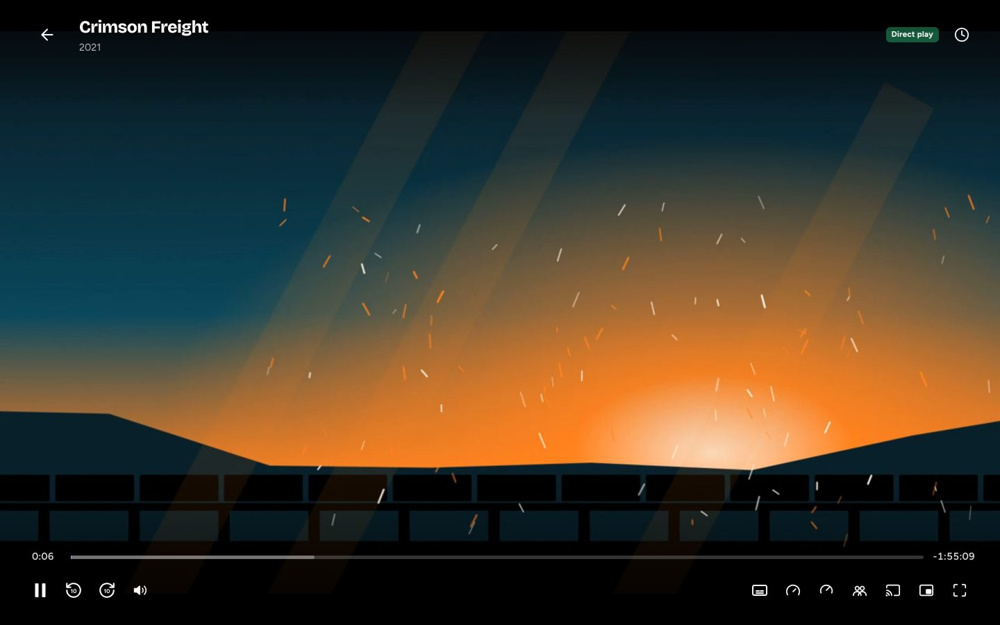
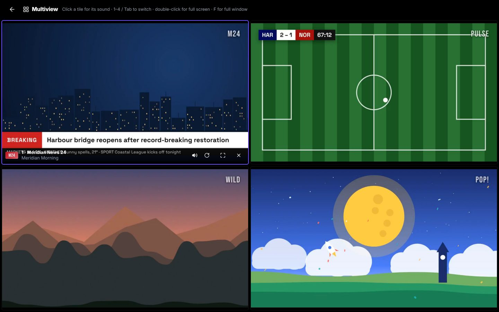
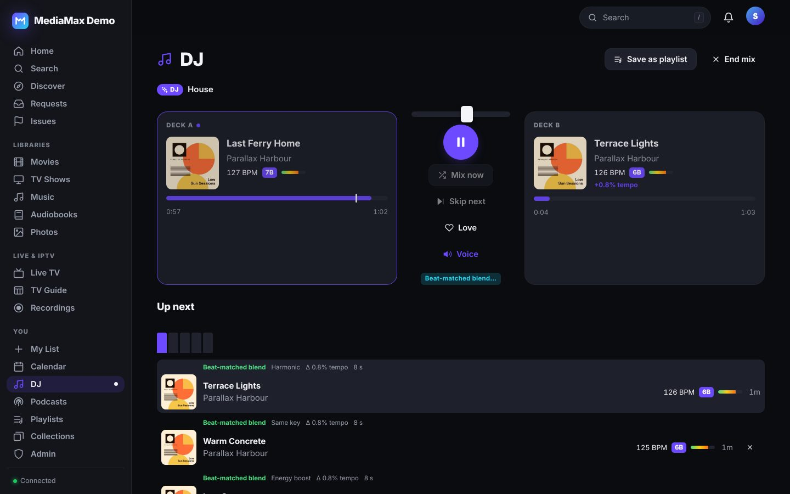
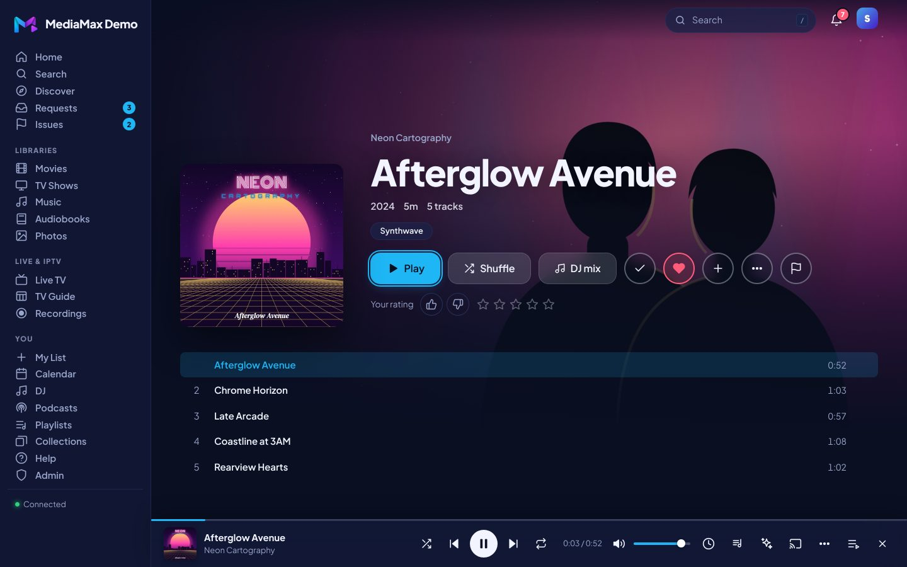
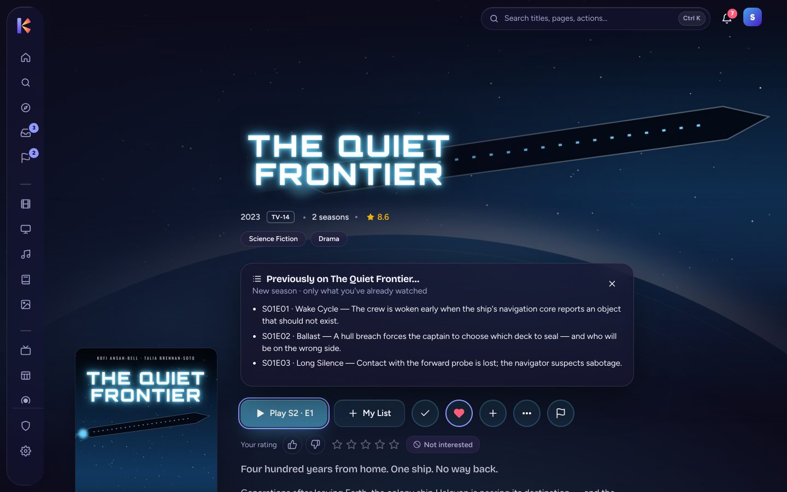
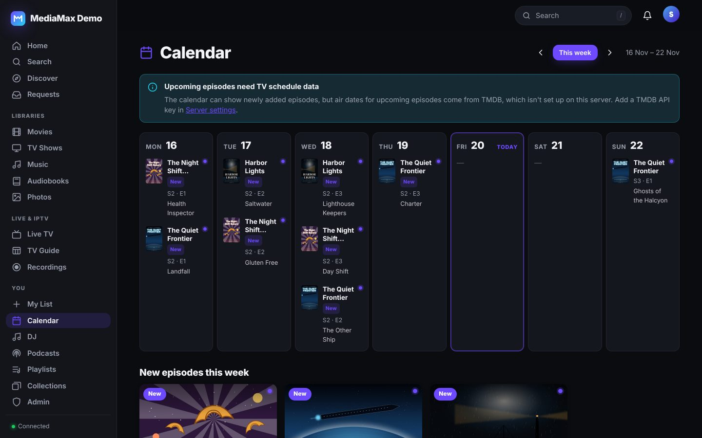
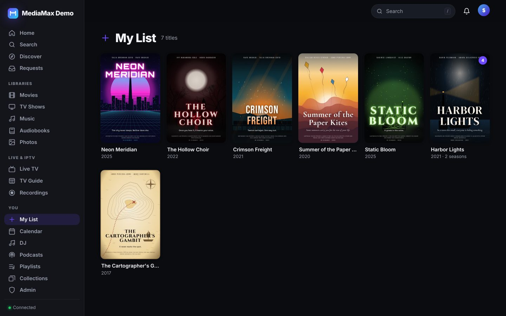
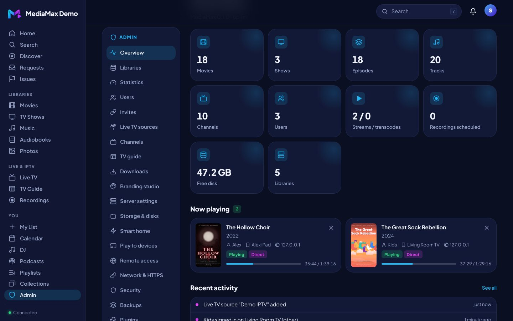
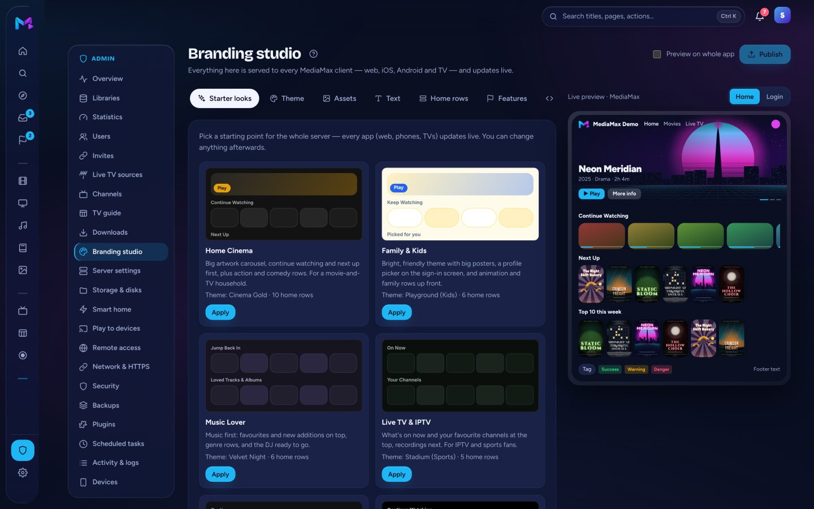
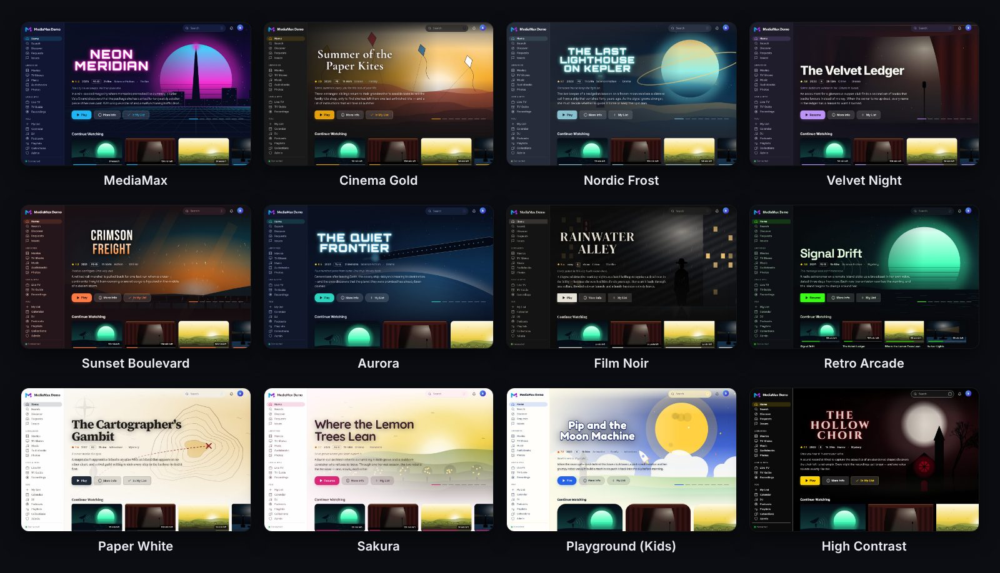

<div align="center">

# MediaMax

**One self-hosted server for movies, TV, music, audiobooks, podcasts, photos, live TV and IPTV, with apps that wear *your* brand.**

[](https://claude.com/claude-code)
[](LICENSE)
[](https://github.com/Bucifer6/MediaMax/actions/workflows/ci.yml)
[](https://github.com/Bucifer6/MediaMax/actions/workflows/apps.yml)

[Features](#features) · [Screenshots](#screenshots) · [Themes](#themes) · [Install](#install) · [Apps](#apps) · [Docs](#documentation) · [Built with Claude Code](#built-with-claude-code)


</div>

MediaMax brings together the features people love in **Plex, Jellyfin and Emby** and the polish of the big streaming services. It adds first-class **Xtream Codes IPTV**, a beat-matching **DJ mode** with an optional **AI DJ**, and a **one-command secure deployment**. Every client (web, iOS, Android, Apple TV, Android TV, Fire TV, Samsung and LG TVs) takes its logo, colours, fonts, home layout and features from your server, applied live with no app rebuild.

> [!NOTE]
> **This entire project, from the server and web app to the mobile and TV apps, deployment kit, docs and tests, was designed and written by [Claude Code](https://claude.com/claude-code)**, Anthropic's agentic coding tool, working from a short brief. See [Built with Claude Code](#built-with-claude-code).

---

## Features

<table>
<tr><td width="50%" valign="top">

**🎬 Libraries & playback**
- Movies, TV, music, audiobooks, podcasts, photos, home videos
- Local NFO/artwork, TMDB, plus TheTVDB, fanart.tv, TheAudioDB, Audnexus, MusicBrainz and more
- Direct play, remux or transcode per device, with on-demand HLS and instant seeking
- Hardware transcoding (VA-API, QSV, NVENC, VideoToolbox, V4L2) and HDR → SDR tone mapping
- Skip intro, credits, recaps and ad breaks; scrub previews; editions and extras
- Cinema mode (trailers and pre-rolls), watch-together, Chromecast, "Play on…" another device
- Subtitle styling and sync, OpenSubtitles search, picture-in-picture, stats overlay

</td><td width="50%" valign="top">

**📺 Live TV & IPTV**
- **Xtream Codes**, M3U and HDHomeRun, with VOD and series as real libraries
- TV guide from XMLTV, Schedules Direct, HDHomeRun and community guides, with fuzzy channel matching
- Catch-up and timeshift, plus tuner sharing (one upstream connection per channel)
- **Multiview**: up to four channels at once
- DVR with series rules, priorities, conflict detection and comskip ad markers

</td></tr>
<tr><td valign="top">

**🎧 Music, DJ & AI DJ**
- Gapless playback, crossfade, ReplayGain, synced lyrics, song and artist radio
- **DJ mode**: BPM, key and energy analysis, harmonic auto-mixes and beat-matched two-deck crossfades
- **AI DJ**: ask in plain words ("chilled 90s house, 1 hour"); a voice host talks between songs. Free by default; can use local models (Ollama) or free and cheap hosted APIs
- Subsonic/OpenSubsonic API for Symfonium, Feishin, Sonos and more
- CarPlay and Android Auto

</td><td valign="top">

**✨ Discovery**
- Recommended for you, Because you watched, Top 10 this week, Popular now
- My List, 👍/👎, Not interested
- Upcoming-episodes calendar and new-episode notifications
- Trailer previews in the hero and on hover
- Per-user "Wrapped" year in review

</td></tr>
<tr><td valign="top">

**👪 Users & security**
- Profiles with PINs, kids-friendly looks, parental ratings that understand US/UK/DE/AU systems
- Two-factor sign-in, invite links, single sign-on (OIDC), API keys
- Per-user stream limits and home-network-only accounts
- **Security dashboard**: sign-in attempts, proxy traffic, HTTPS certificate, and CrowdSec/fail2ban bans with one-click unban

</td><td valign="top">

**🧩 Integrations & admin**
- Requests flow (Overseerr-style) into **Radarr, Sonarr, Lidarr and Readarr**, with a downloads dashboard and instant imports
- Trakt, Last.fm, OpenSubtitles, Bazarr, DLNA, webhooks, Prometheus metrics
- Plugin system (repositories, settings UI, events, routes, metadata providers)
- Backups and restore, UPnP port mapping, scheduled tasks, activity log

</td></tr>
</table>

The full comparison with Plex, Jellyfin and Emby is in **[docs/FEATURES.md](docs/FEATURES.md)**.

## Screenshots

| | |
|---|---|
|  **Movie details**: editions, extras, cast, ratings |  **Player**: skip markers, subtitles, stats, Play on… |
|  **TV guide** with catch-up and one-click recording |  **Multiview**: four live channels at once |
|  **DJ mode**: beat-matched two-deck mixing |  **AI DJ**: describe the mix, the host does the rest |
|  **Music** with gapless playback, lyrics and radio |  **TV shows**: seasons, next up, upcoming episodes |
|  **Calendar** of new and upcoming episodes |  **My List** |
|  **Admin dashboard**: live sessions, stats, tasks |  **Security**: CrowdSec, fail2ban, proxy and certificate |
|  **Branding studio**: live preview, every app re-skins |  **Starter looks**: one click to a whole new feel |

<p align="center">
  
  &nbsp;&nbsp;
  
  <br><em>On a phone, and on a TV with remote-control navigation</em>
</p>

## Themes

24 built-in themes, each with its own colours, font, card shape and hero style, and every one meets **WCAG AA contrast**. Admins pick the default, can let people choose their own, or design new ones in the Branding Studio. **Starter looks** (Home Cinema, Family & Kids, Music Lover, Live TV & IPTV, Minimal, Easy to See) set the theme, home rows and features in one click.



<details>
<summary>All 24 themes</summary>

| Dark | | | Light & special |
|---|---|---|---|
| Midnight | Cinema Gold | Oceanic | Daylight |
| Crimson | Emerald | Pure OLED | Paper White |
| Synthwave | Nordic Frost | Velvet Night | Sakura |
| Sunset Boulevard | Forest Cabin | Retro Arcade | Fresh Mint |
| Film Noir | Aurora | Espresso | Playground (Kids) |
| Slate Pro | Stadium (Sports) | Festive | High Contrast (accessibility) |

</details>

## Install

FFmpeg is included in every option. Then open `http://<server>:8484` and follow the setup wizard.

| Platform | How |
|---|---|
| **Linux server, secure & public** | `curl -fsSL https://raw.githubusercontent.com/Bucifer6/MediaMax/main/deploy/install.sh \| sudo bash` sets up Docker, HTTPS through **Caddy** or **Nginx**, **CrowdSec** and/or **fail2ban**, and hardened defaults. See [docs/DEPLOY.md](docs/DEPLOY.md) |
| **Docker** (amd64, arm64) | `docker run -d -p 8484:8484 -v "$PWD/config:/config" -v /path/to/media:/media:ro ghcr.io/bucifer6/mediamax` |
| **NAS**: Synology, QNAP, Unraid, TrueNAS SCALE, OpenMediaVault | ready-made templates in [`nas/`](nas) |
| **Windows** x64 | `mediamax-<version>-windows-x64.zip` from [Releases](https://github.com/Bucifer6/MediaMax/releases/latest): run `MediaMax.cmd`, or `install-service.ps1` to start at boot |
| **Linux** x64 / arm64 | `mediamax-<version>-linux-<arch>.tar.gz`: run `./mediamax`, or install the included systemd unit |

Step-by-step guides, hardware transcoding, upgrades and backups are in **[docs/INSTALL.md](docs/INSTALL.md)**. Optional free add-ons for the AI DJ (Ollama, Kokoro, Piper) are covered there too.

<details>
<summary><b>From source</b></summary>

Requires **Node.js 22.5+** and **FFmpeg** on the PATH.

```bash
npm install
```
```bash
npm run build
```
```bash
npm start
```

The server listens on port **8484** and serves the web app and API. For development, run `npm run dev:server` and `npm run dev:web`.

</details>

<details>
<summary><b>Configuration (environment variables)</b></summary>

| Variable | Default | Purpose |
|---|---|---|
| `MEDIAMAX_PORT` | `8484` | HTTP port |
| `MEDIAMAX_DATA` | `./data` ([binaries and Docker](docs/INSTALL.md#where-your-data-lives-and-backups) differ) | Database, caches, branding assets, logs |
| `MEDIAMAX_TRANSCODE_DIR` | `$DATA/transcodes` | HLS segment scratch space (a RAM disk is ideal) |
| `MEDIAMAX_RECORDINGS` | `$DATA/recordings` | DVR output folder |
| `MEDIAMAX_FFMPEG` / `MEDIAMAX_FFPROBE` | bundled, else on the PATH | Custom binaries (e.g. jellyfin-ffmpeg) |
| `MEDIAMAX_HWACCEL` | `none` | Initial hardware accelerator |
| `MEDIAMAX_TRUSTED_PROXIES` | loopback + private ranges | Proxies whose `X-Forwarded-*` headers are trusted |
| `TMDB_API_KEY` | | Online metadata (also settable in the admin UI) |
| `MEDIAMAX_LOG_LEVEL` | `info` | `debug` for verbose logs |

More, including the security dashboard and integration variables, is in [docs/INSTALL.md](docs/INSTALL.md) and [docs/DEPLOY.md](docs/DEPLOY.md).

</details>

## Apps

| Client | Status |
|---|---|
| **Web** (any browser) | ✅ Served by the server; responsive down to phones |
| **Samsung (Tizen) & LG (webOS)** | ✅ Wrapper apps in [`tv/`](tv) that load the web app in TV mode (D-pad navigation, remote keys) |
| **iOS / iPadOS, Android** | 🧪 Built from [`apps/mobile`](apps/mobile) with Expo. Compiled in CI ([Native apps](https://github.com/Bucifer6/MediaMax/actions/workflows/apps.yml)); store release needs your developer accounts |
| **Apple TV, Android TV, Fire TV** | 🧪 Same codebase, TV builds compiled in CI; installable Android TV/Fire TV APKs are produced on every change |
| **CarPlay, Android Auto** | 🧪 Native module in the mobile app; CarPlay needs Apple's audio entitlement |
| **Subsonic apps, DLNA players** | ✅ Through the built-in Subsonic API and DLNA server |

🧪 means it compiles and is ready for device testing and store submission; it hasn't been through store review yet. Debug-signed Android APKs can be downloaded from the latest [Native apps](https://github.com/Bucifer6/MediaMax/actions/workflows/apps.yml) run. White-labelling (your own name, icon and colours in the store) is one command; see [apps/mobile/README.md](apps/mobile/README.md).

## Documentation

| | |
|---|---|
| [docs/INSTALL.md](docs/INSTALL.md) | Install on Docker, NAS, Windows and Linux; upgrades, backups, hardware transcoding |
| [docs/DEPLOY.md](docs/DEPLOY.md) | One-command secure deployment: Caddy/Nginx, CrowdSec, fail2ban, Cloudflare Tunnel, Tailscale |
| [docs/FEATURES.md](docs/FEATURES.md) | Feature-by-feature comparison with Plex, Jellyfin and Emby |
| [docs/API.md](docs/API.md) | REST and WebSocket API reference |
| [docs/PLUGINS.md](docs/PLUGINS.md) | Writing plugins; examples in [`plugins/examples`](plugins/examples) |
| [docs/ROADMAP.md](docs/ROADMAP.md) | What's next |
| [apps/mobile/README.md](apps/mobile/README.md) | Building the phone, tablet, TV and car apps |

<details>
<summary><b>Adding IPTV</b></summary>

Go to **Admin → Live TV → Add source → Xtream Codes**, enter the portal URL, username and password, and press **Test**. You'll see the account status, expiry and channel/VOD/series counts. On save, MediaMax:

1. imports live channels and categories and loads the provider's guide (add more guide sources under **Admin → Live TV → Guide**);
2. creates **"<name> Movies"** and **"<name> Series"** libraries from the VOD catalogue, which browse, search, resume and play like local media;
3. restreams through the server (hiding your credentials), shares one upstream connection per channel, and warns before you exceed the provider's connection limit;
4. enables **catch-up** on channels that support it.

M3U playlists (`url-tvg`, `tvg-*`, `catchup-source`) and HDHomeRun tuners work too.

</details>

<details>
<summary><b>Branding your server</b></summary>

**Admin → Branding studio** controls everything the apps show:

- server name, tagline, login message, footer and support link;
- logo, wide logo, favicon, app icon, splash and login background;
- themes, starter looks, and your own themes (13 colour tokens, radius, font, poster shape, card size, hero style);
- the home screen rows and their order;
- feature toggles that hide areas in every app;
- custom CSS.

Every connected app receives a `branding.updated` event and re-themes instantly.

</details>

<details>
<summary><b>Use your favourite music apps (Subsonic)</b></summary>

MediaMax speaks the **Subsonic / OpenSubsonic API** at `http://<server>:8484/rest`. Players such as Symfonium, Feishin, play:Sub, Amperfy, Substreamer and Sonos bridges can browse, search, stream (with transcoding and ReplayGain), star, scrobble, edit playlists and show synced lyrics. Sign in with your MediaMax username and password, or with an API key if you use two-factor sign-in.

</details>

<details>
<summary><b>Security notes</b></summary>

- Use the [deploy kit](docs/DEPLOY.md) or put MediaMax behind HTTPS yourself, and set **Public URL** in settings.
- Failed sign-ins are written to a security log that fail2ban and CrowdSec read. Accounts lock for 15 minutes after 5 failures, whatever the client IP.
- Administrators always need a password; passwordless profiles are for non-admin, non-SSO accounts only.
- Content from IPTV playlists and podcast feeds is treated as untrusted: only network URLs are accepted, images must be raster images, and user-added feeds can't reach private addresses.
- API keys for AI and integration services are write-only in the admin UI.

</details>

## Repository layout

```
shared/        API contract (TypeScript types used by every client)
server/        MediaMax server (Fastify, node:sqlite, FFmpeg)
web/           Web app and admin dashboard (React + Vite)
apps/mobile/   iOS, Android, Apple TV, Android TV and Fire TV apps (Expo / React Native) + CarPlay/Android Auto
tv/            Samsung Tizen and LG webOS wrapper apps
deploy/        One-command installer, Caddy/Nginx, CrowdSec and fail2ban configs
nas/           Templates for Synology, QNAP, Unraid, TrueNAS SCALE and OpenMediaVault
packaging/     Files shipped in the Windows and Linux release archives
plugins/       Plugin SDK and examples
scripts/       Release packaging, end-to-end smoke test, screenshot generator
docs/          Install, deploy, API, features, plugins
```

## Development & testing

```bash
npm test
```

That runs the server unit tests: parsing, playback decisions, IPTV/XMLTV, DSP for DJ mode, recommendations, security, and more. CI also builds the web app, type-checks and compiles the native apps, builds the Docker image and a standalone binary, and runs a browser smoke test over every page (`node scripts/e2e-smoke.cjs`).

To refresh the screenshots above:

```bash
npm run screenshots
```

It generates fictional demo media and artwork, boots a throwaway server, and captures every screen.

## Built with Claude Code

MediaMax was built end to end by **[Claude Code](https://claude.com/claude-code)**, Anthropic's agentic coding tool. It started from a short brief: *"build a media server that combines Plex, Jellyfin and Emby with Xtream IPTV, apps for phones and TVs, all customisable from the server."*

Claude Code designed the architecture and wrote the server, web app, mobile, TV and car apps, deployment kit, tests and documentation. It worked through the usual engineering loop: building features, running unit tests, end-to-end browser tests and real tools (FFmpeg, CrowdSec, fail2ban, Caddy, Nginx), reading CI logs and fixing what failed. For larger pieces it ran several agents in parallel, each on a separate part of the codebase. Every change went through pull requests with CI before merging.

The project's owner steered the direction with feature requests; the code is Claude Code's.

## License

MediaMax is open source under the [MIT License](LICENSE). You're free to use, modify and redistribute it, including publishing your own branded builds of the apps, as long as the licence notice is kept.

Third-party services you connect (TMDB, Trakt, Last.fm, OpenSubtitles, IPTV providers, Schedules Direct, AI providers) have their own terms; make sure your use of them complies. FFmpeg is used as a separate program and is licensed under the LGPL/GPL.

<div align="center"><sub>Made with <a href="https://claude.com/claude-code">Claude Code</a></sub></div>
